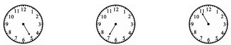

# Mathematics (Grade 3)

**ID**: 5628ed51
**难度**: hard
**题型**: fill_in_the_blank

## 题目
写出分针从12旋转到下面各个位置时所经过的时间。

  $\underline{\hspace{5em}}$ 分                                       $\underline{\hspace{5em}}$ 分                                         $\underline{\hspace{5em}}$ 分

## 解答

**答案**: 25, 35, 55

1. Step1:观察第一个钟面，分针指向5，确定分针从12开始经过了5大格
2. Step2:根据钟面知识，分针每经过1大格是5分钟，计算第一个钟面分针经过的时间为5×5=25分钟
3. Step3:观察第二个钟面，分针指向7，确定分针从12开始经过了7大格
4. Step4:计算第二个钟面分针经过的时间为5×7=35分钟
5. Step5:观察第三个钟面，分针指向11，确定分针从12开始经过了11大格
6. Step6:计算第三个钟面分针经过的时间为5×11=55分钟

## 知识点

**知识点**:
  - 时、分、秒的认识、进率及换算

---
