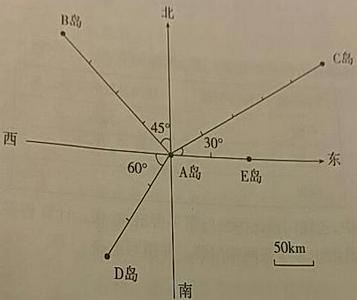

# Mathematics (Grade 3)

**ID**: 58576a4d
**难度**: hard
**题型**: fill_in_the_blank

## 题目

 B岛 北 C岛 西 45° 30° 东  60° D岛 A岛 E岛 东 南 50km
 以A岛为观测点．
  1.B岛在（）偏（）（）方向上，距离是（）km.
 2.C岛在（）偏（）（）方向上，距离是（）km.
 3.D岛在（）偏（）（）方向上，距离是（）km.

## 解答

**答案**: 北, 西, 45°, 200, 东, 北, 30°, 250, 西, 南, 60°, 150

1. Step1:根据题意，明确以A岛为观测点，地图上方向有东、南、西、北等多种，且1小格代表50千米
2. Step2:观察B岛，其在北偏西方向，夹角为45°，数得距离A岛有4小格，所以距离为4×50 = 200km
3. Step3:观察C岛，其在东偏北方向，夹角为30°，数得距离A岛有5小格，所以距离为5×50 = 250km
4. Step4:观察D岛，其在西偏南方向，夹角为60°，数得距离A岛有3小格，所以距离为3×50 = 150km

## 知识点

**知识点**:
  - --

---
