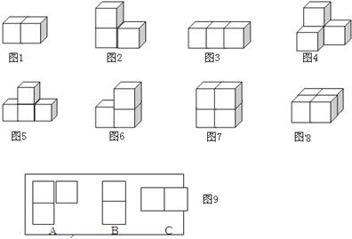

# Mathematics (Grade 3)

**ID**: 5a2cdf91
**难度**: hard
**题型**: fill_in_the_blank

## 题目
仔细看图，填图号．
（1）从图1至图8上面看到图9中A的有$\underline{\hspace{5em}}$．
（2）从图1至图8右面看到的图9中B的有$\underline{\hspace{5em}}$．
（3）从图1至图8正面看到的图9中C的有$\underline{\hspace{5em}}$．

## 解答

**答案**: 图形4, 图形2、5、6、7, 图形1、8

1. Step1:观察图1至图8从上面看的形状，发现只有图形4从上面看是2行，后面一行是2个正方形，前面一行1个正方形靠左边，符合图9中A的形状，所以从图1至图8上面看到图9中A的是图形4
2. Step2:观察图1至图8从右面看的形状，发现图形2、5、6、7从右面看是1列，有2个正方形，符合图9中B的形状，所以从图1至图8右面看到图9中B的是图形2、5、6、7
3. Step3:观察图1至图8从正面看的形状，发现图形1、8从正面看是1行，有2个正方形，符合图9中C的形状，所以从图1至图8正面看到图9中C的是图形1、8

## 知识点

**知识点**:
  - 从不同方向观察物体和几何体．

---
