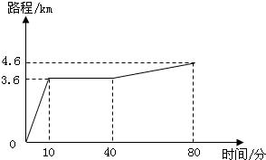

# Mathematics (Grade 3)

**ID**: 5d5d5de9
**难度**: hard
**题型**: fill_in_the_blank

## 题目
周末，小光去家里出发，先去3.6km外的图书馆借书．去时由妈妈乘公交车陪同．借完书后，小光独自步行去爷爷家．小光行程情况如下图．
(1)公交车的平均速度是每小时______km．
(2)小光在图书馆借书用了______时．
(3)求小光步行的平均速度．

## 解答

**答案**: 21.6, 0.5, 1.5

1. Step1:将10分钟换算为小时，10分钟 = 10÷60 = 1/6小时，根据速度=路程÷时间，可得公交车平均速度为3.6÷(1/6)=21.6千米/小时
2. Step2:计算小光在图书馆借书时间，40 - 10 = 30分钟，将30分钟换算为小时，30÷60 = 0.5小时
3. Step3:计算小光步行时间，80 - 40 = 40分钟，将40分钟换算为小时，40÷60 = 2/3小时，计算步行路程为4.6 - 3.6 = 1千米，根据速度=路程÷时间，可得步行平均速度为1÷(2/3)=1.5千米/小时

## 知识点

**知识点**:
  - 简单的行程问题;平均数的含义及求平均数的方法．

---
