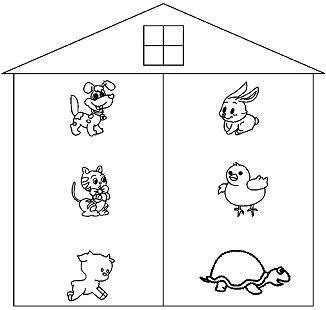

# Mathematics (Grade 3)

**ID**: 6147969b
**难度**: hard
**题型**: fill_in_the_blank

## 题目
楼房里的小动物正在欢迎你。（lóu fáng lǐ de xiǎo dòng wù zhèng zài huān yíng nǐ）

1.小狗住在小猫的（）面
小鸡住在小兔的（）面
小羊住在乌龟的（）面
小鸡住在小猫的（）面
2.小狗和小兔住在最（）面
小羊和乌龟住在最（）面
3.楼里一共住了（）只小动物。

## 解答

**答案**: 上, 下, 左, 右, 上, 下, 6

1. Step1:观察图片，确定小狗在小猫的位置，离底面较远的为上面，得出小狗住在小猫的上面
2. Step2:观察图片，确定小鸡在小兔的位置，离底面较近的为下面，得出小鸡住在小兔的下面
3. Step3:观察图片，确定小羊在乌龟的位置，写字的手为右手，其相反方向为左，得出小羊住在乌龟的左面
4. Step4:观察图片，确定小鸡在小猫的位置，写字的手为右手，得出小鸡住在小猫的右面
5. Step5:观察图片，确定小狗和小兔的位置，离底面最远的是最上面，得出小狗和小兔住在最上面
6. Step6:观察图片，确定小羊和乌龟的位置，离底面最近的是最下面，得出小羊和乌龟住在最下面
7. Step7:结合整数的认识，数一数图片中小动物的数量，得出楼里一共住了6只小动物

## 知识点

**知识点**:
  - 

---
