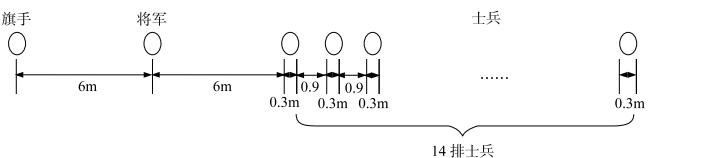

# Mathematics (Grade 3)

**ID**: 68038029
**难度**: hard
**题型**: fill_in_the_blank

## 题目
在“9·3”阅兵式上，有10个英模方队接受检阅，下面是一个方队的示意图（图中一个○表示一个人）

（1）方队中，旗手脚尖到将军脚尖6米，将军脚尖到第一排士兵脚尖6米，后面14排都是前一排脚跟到后一排脚尖0.9米，脚长0.3米。这个方队长（）米。
（2）如果阅兵区的长度是96米，方队前进的速度是1.4米/秒，那么一个方队从旗手进入阅兵区，到最后一排离开阅兵区，需要（）秒。

## 解答

**答案**: 27.9, 88.5

1. Step1:计算旗手到第一排士兵脚尖的长度，为6×2 = 12米
2. Step2:计算14排士兵的脚长，为0.3×14 = 4.2米
3. Step3:计算14排士兵的间距总长，因为有14 - 1个间距，每个间距0.9米，所以为0.9×(14 - 1)=11.7米
4. Step4:计算方队长，将上述结果相加，12 + 4.2 + 11.7 = 27.9米
5. Step5:计算从旗手进入阅兵区到最后一排离开阅兵区的总长度，为阅兵区长度加上方队长度，即96 + 27.9 = 123.9米
6. Step6:计算所需时间，根据时间 = 路程÷速度，可得123.9÷1.4 = 88.5秒

## 知识点

**知识点**:
  - 火车完全过桥(奥数)

---
