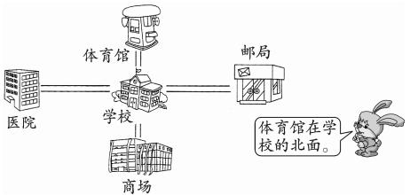

# Mathematics (Grade 3)

**ID**: 68490d04
**难度**: hard
**题型**: fill_in_the_blank

## 题目
看图辨方向。

1.医院在学校的（）面，邮局在学校的（）面。
2.（）在学校的南面，体育馆的南面是（）。
3.医院的东面是（）和（）。
4.（）和（）在商场的北面。

## 解答

**答案**: 西, 东, 商场, 学校, 学校, 邮局, 体育馆, 学校

1. Step1:根据地图上北、下南、左西、右东的位置关系，医院在学校的左面，所以医院在学校的西面
2. Step2:邮局在学校的右面，所以邮局在学校的东面
3. Step3:学校下面的建筑物是商场，所以商场在学校的南面
4. Step4:体育馆下面的建筑物是学校，所以体育馆的南面是学校
5. Step5:医院右面的建筑物是学校和邮局，所以医院的东面是学校和邮局
6. Step6:商场上面的建筑物是体育馆和学校，所以体育馆和学校在商场的北面

## 知识点

**知识点**:
  - 辨认方向

---
