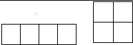

# Mathematics (Grade 3)

**ID**: 6ade5b51
**难度**: hard
**题型**: fill_in_the_blank

## 题目
如图是用1平方厘米的正方形摆成的两个图形，
长方形的周长是$\underline{\hspace{5em}}$      厘米，
正方形的周长是$\underline{\hspace{5em}}$      厘米；
长方形的面积是$\underline{\hspace{5em}}$      平方厘米，
正方形的面积是$\underline{\hspace{5em}}$      平方厘米．

## 解答

**答案**: 10, 8, 4, 4

1. Step1:由1平方厘米的正方形可知其边长为1厘米
2. Step2:长方形的长由4个正方形边长组成，所以长为4厘米，宽由1个正方形边长组成，所以宽为1厘米
3. Step3:根据长方形周长公式C=(a + b)×2，可得长方形周长为(4 + 1)×2 = 10厘米
4. Step4:根据长方形面积公式S = ab，可得长方形面积为4×1 = 4平方厘米
5. Step5:正方形的边长由2个正方形边长组成，所以边长为2厘米
6. Step6:根据正方形周长公式C = 4a，可得正方形周长为4×2 = 8厘米
7. Step7:根据正方形面积公式S = a²，可得正方形面积为2×2 = 4平方厘米

## 知识点

**知识点**:
  - 长方形的周长;正方形的周长;长方形、正方形的面积

---
