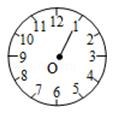

# Mathematics (Grade 3)

**ID**: 6bae03e3
**难度**: hard
**题型**: fill_in_the_blank

## 题目
（1）指针从“1”绕点O顺时针旋转60°后指向 $\underline{\hspace{5em}}$ 
（2）指针从“1”绕点O逆时针旋转90°后指向 $\underline{\hspace{5em}}$ 。

## 解答

**答案**: 3, 10

1. Step1:明确钟表上每一大格的度数为30°
2. Step2:计算指针从“1”绕点O顺时针旋转60°时走过的大格数，60°÷30°=2
3. Step3:根据计算结果，指针从“1”绕点O顺时针走2大格，确定指向3
4. Step4:计算指针从“1”绕点O逆时针旋转90°时走过的大格数，90°÷30°=3
5. Step5:根据计算结果，指针从“1”绕点O逆时针走3大格，确定指向10

## 知识点

**知识点**:
  - 图形的旋转;时、分、秒的认识、进率及换算

---
