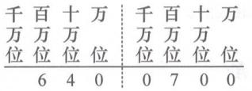

# Mathematics (Grade 3)

**ID**: 731fe6dc
**难度**: hard
**题型**: fill_in_the_blank

## 题目
填一填。 
1.

640在（）级上，表示640个（）。
7在（）位上，表示7个（）。
2.10个一百万是（），一亿是（）个一千万。
3.数级分为（）、（）、（）……
4.2500000是由（）个百万和（）个十万组成的。
5.一个八位数，它的最高位是（）位。

## 解答

**答案**: 万, 万, 百, 百, 一千万, 10, 个级, 万级, 亿级, 2, 5, 千万

1. Step1:观察数字640所在位置，根据整数数位顺序表，每四个数位为一级，可知640在万级上，万级上的数表示几个万，所以640表示640个万
2. Step2:观察数字7所在位置，可知7在百位上，百位上的数字表示几个百，所以7表示7个百
3. Step3:根据计数单位的进率，10个一百万是10×1000000 = 10000000，即一千万
4. Step4:因为一亿是100000000，一千万是10000000，100000000÷10000000 = 10，所以一亿是10个一千万
5. Step5:根据数级的知识，数级分为个级、万级、亿级
6. Step6:分析2500000，百万位上是2，所以有2个百万，十万位上是5，所以有5个十万
7. Step7:根据数位顺序表，八位数的最高位是千万位

## 知识点

**知识点**:
  - 数位顺序表;万以上数的认识

---
