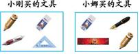

# Mathematics (Grade 3)

**ID**: 7baa7fbb
**难度**: hard
**题型**: fill_in_the_blank

## 题目
（1）小刚买了$\underline{\hspace{5em}}$      种文具，小娜买了$\underline{\hspace{5em}}$      种文具，两人一共买了$\underline{\hspace{5em}}$      种文具．
（2）两人买的相同的文具是$\underline{\hspace{5em}}$      ．

## 解答

**答案**: 4, 4, 6, 铅笔和橡皮

1. Step1:观察图片，数出小刚所买文具的种类数量，得到小刚买了4种文具
2. Step2:观察图片，数出小娜所买文具的种类数量，得到小娜买了4种文具
3. Step3:找出小刚和小娜所买文具中相同的，确定为铅笔和橡皮，共2种
4. Step4:计算两人一共买的文具种数，用小刚买的文具种数加上小娜买的文具种数再减去相同文具的种数，即4 + 4 - 2 = 6种
5. Step5:确定两人买的相同的文具为铅笔和橡皮

## 知识点

**知识点**:
  - 容斥原理

---
