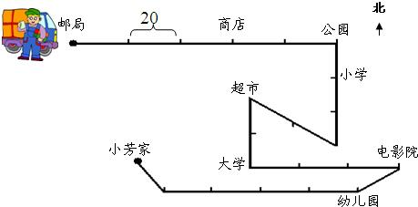

# Mathematics (Grade 3)

**ID**: 8155ee78
**难度**: hard
**题型**: fill_in_the_blank

## 题目

（1）邮递员叔叔从邮局出发向东行驶$\underline{\hspace{5em}}$米到商店，再向$\underline{\hspace{5em}}$行驶$\underline{\hspace{5em}}$米到公园．
（2）小芳从家出发向$\underline{\hspace{5em}}$走$\underline{\hspace{5em}}$米到幼儿园，再向$\underline{\hspace{5em}}$走$\underline{\hspace{5em}}$米到电影院，然后向西走60米到$\underline{\hspace{5em}}$，最后向$\underline{\hspace{5em}}$走$\underline{\hspace{5em}}$米到超市．
（3）邮递员叔叔从邮局出发，第一封信是送到小学，请你写出邮递员叔叔的行走路线和米数．
$\underline{\hspace{5em}}$
（4）邮递员叔叔从邮局出发，到小芳家，全程走了$\underline{\hspace{5em}}$米．

## 解答

**答案**: 60, 东, 40, 东南, 100, 东北, 20, 大学, 北, 40, 从邮局出发向东行驶 60米到商店，再向 东行驶 40米到公园，再向南行驶20米到达小学, 420

1. Step1:根据地图方向辨别方法‘上北下南，左西右东’以及图上标注信息，计算邮局到商店的距离，图上距离为3厘米，因为图上1厘米代表实际距离20米，所以3×20 = 60米，得出邮递员叔叔从邮局出发向东行驶60米到商店
2. Step2:确定商店到公园的方向为东，计算商店到公园的距离，图上距离为2厘米，2×20 = 40米，即再向东行驶40米到公园
3. Step3:确定小芳从家出发到幼儿园的方向为东南，计算家到幼儿园的距离，图上距离为5厘米，5×20 = 100米，即向东南走100米到幼儿园
4. Step4:确定小芳从幼儿园到电影院的方向为东北，计算幼儿园到电影院的距离，图上距离为1厘米，1×20 = 20米，即再向东北走20米到电影院
5. Step5:确定小芳从电影院向西走60米到达的地点为大学
6. Step6:确定小芳从大学到超市的方向为北，计算大学到超市的距离，图上距离为2厘米，2×20 = 40米，即最后向北走40米到超市
7. Step7:确定邮递员叔叔送第一封信到小学的行走路线和米数，从邮局出发向东行驶60米到商店，再向东行驶40米到公园，再向南行驶20米到达小学
8. Step8:计算邮递员叔叔从邮局到小芳家的全程距离，邮局到小芳家图上距离共21厘米，20×21 = 420米

## 知识点

**知识点**:
  - 路线图．

---
