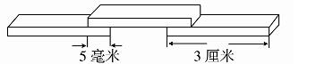

# Mathematics (Grade 3)

**ID**: 82d6042c
**难度**: hard
**题型**: fill_in_the_blank

## 题目
有几根长短和形状相同的木条钉在一起后如下图所示，这样的三根木条钉在一起长（）毫米，五根木条钉在一起长（）毫米。

## 解答

**答案**: 80, 130

1. Step1:将3厘米换算为30毫米
2. Step2:计算三根木条不重合时的总长度为30×3 = 90毫米
3. Step3:计算三根木条重合部分的长度为5×(3 - 1) = 10毫米
4. Step4:计算三根木条钉在一起的长度为90 - 10 = 80毫米
5. Step5:计算五根木条不重合时的总长度为30×5 = 150毫米
6. Step6:计算五根木条重合部分的长度为5×(5 - 1) = 20毫米
7. Step7:计算五根木条钉在一起的长度为150 - 20 = 130毫米

## 知识点

**知识点**:
  - 平面图形的折叠(奥数)

---
