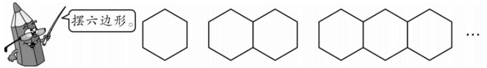

# Mathematics (Grade 3)

**ID**: 87afba6f
**难度**: hard
**题型**: fill_in_the_blank

## 题目

（ 1）摆1个六边形需要（）根小棒，摆2个六边形需要（）根小棒，摆3个六边形需要（）根小棒。
（2）像这样摆下去，摆n个六边形需要（）根小棒；当n=15时，一共需要（）根小棒。
（3）2016根小棒可以摆（）个这样的六边形。

## 解答

**答案**: 6, 11, 16, 5n+1, 76, 403

1. Step1:观察可知，摆1个六边形需要6根小棒
2. Step2:因为每多摆一个六边形增加5根小棒，所以摆2个六边形需要6 + 5 = 11根小棒
3. Step3:摆3个六边形需要6 + 5×2 = 16根小棒
4. Step4:总结规律可得，摆n个六边形需要5n + 1根小棒
5. Step5:当n = 15时，代入5n + 1，即5×15 + 1 = 76根小棒
6. Step6:当小棒总数为2016根时，令5n + 1 = 2016，解得n = (2016 - 1)÷5 = 403个六边形

## 知识点

**知识点**:
  - 

---
