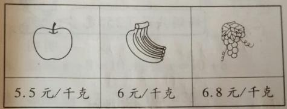

# Mathematics (Grade 3)

**ID**: 8f446ddb
**难度**: hard
**题型**: fill_in_the_blank

## 题目

 1．买
 $b$
  千克香蕉需要（    ）元．
 2．
 $m$
  元钱可以买（    ）千克苹果或（    ）千克葡萄．
 3．买
 $a$
  千克香蕉和
  $b$
   千克苹果一共需要（    ）元．

## 解答

**答案**: 6b, m/5.5, m/6.8, 6a+5.5b

1. Step1:已知香蕉单价为6元/千克，根据“总价=单价×数量”，买b千克香蕉，总价为6×b = 6b元
2. Step2:已知苹果单价为5.5元/千克，根据“数量=总价÷单价”，m元钱买苹果，数量为m÷5.5 = m/5.5千克
3. Step3:已知葡萄单价为6.8元/千克，根据“数量=总价÷单价”，m元钱买葡萄，数量为m÷6.8 = m/6.8千克
4. Step4:已知香蕉单价为6元/千克，买a千克香蕉的总价为6×a = 6a元，苹果单价为5.5元/千克，买b千克苹果的总价为5.5×b = 5.5b元，所以买a千克香蕉和b千克苹果一共需要6a + 5.5b元

## 知识点

**知识点**:
  - --

---
