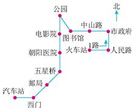

# Mathematics (Grade 3)

**ID**: 90ef6505
**难度**: hard
**题型**: fill_in_the_blank

## 题目
如图是1路公共汽车的行车路线图
（1）1路公共汽车从$\underline{\hspace{5em}}$      开往$\underline{\hspace{5em}}$      ，中间经过了$\underline{\hspace{5em}}$      个站．
（2）小军从图书馆到五星桥，先向$\underline{\hspace{5em}}$      方坐到$\underline{\hspace{5em}}$      ，再向$\underline{\hspace{5em}}$      方坐到五星桥．

## 解答

**答案**: 火车站, 汽车站, 10, 西北, 公园, 南

1. Step1:观察路线图，确定1路公共汽车的起点为火车站
2. Step2:确定1路公共汽车的终点为汽车站
3. Step3:数出从火车站到汽车站中间经过的站点数量为10个
4. Step4:根据地图上“上北下南，左西右东”的方向辨别方法，确定小军从图书馆出发，先向西北方坐到公园
5. Step5:确定小军从公园再向南方坐到五星桥

## 知识点

**知识点**:
  - 路线图

---
