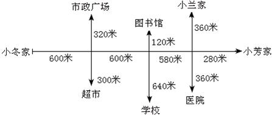

# Mathematics (Grade 3)

**ID**: 9c365ef3
**难度**: hard
**题型**: fill_in_the_blank

## 题目

（1）小冬从家里出发，向$\underline{\hspace{5em}}$走了600米，又向$\underline{\hspace{5em}}$走了$\underline{\hspace{5em}}$米到市政广场．
（2）小兰从家里出发，向$\underline{\hspace{5em}}$走了$\underline{\hspace{5em}}$米到医院．
（3）小芳从家里出发，向$\underline{\hspace{5em}}$走了$\underline{\hspace{5em}}$米，又向$\underline{\hspace{5em}}$走了$\underline{\hspace{5em}}$米到图书馆．
（4）说说小冬、小兰、小芳上学的路线．

## 解答

**答案**: 东, 北, 320, 南, 720, 西, 860, 北, 120

1. Step1:观察图中小冬家到市政广场的路线，根据上北下南左西右东，可知小冬从家里出发，先向东走了600米，接着向北走了320米到市政广场，所以第一个空填东，第二个空填北，第三个空填320
2. Step2:观察图中小兰家到医院的路线，根据上北下南左西右东，小兰从家里出发，向南走了360 + 360 = 720米到医院，所以第四个空填南，第五个空填720
3. Step3:观察图中小芳家到图书馆的路线，根据上北下南左西右东，小芳从家里出发，先向西走了280 + 580 = 860米，又向北走了120米到图书馆，所以第六个空填西，第七个空填860，第八个空填北，第九个空填120

## 知识点

**知识点**:
  - 路线图．

---
