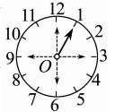

# Mathematics (Grade 3)

**ID**: a53939ac
**难度**: hard
**题型**: fill_in_the_blank

## 题目
看图填一填。

指针从“12”绕点O顺时针旋转30°到“（）”；
指针从“1”绕点O顺时针旋转90°到“（）”；
指针从“6”绕点O顺时针旋转（）°到“12”。

## 解答

**答案**: 1, 4, 180

1. Step1:计算钟面上相邻两个数字间的角度，360÷12=30°
2. Step2:计算指针从“12”绕点O顺时针旋转30°走过的格数，30÷30=1，确定指针指向“1”
3. Step3:计算指针从“1”绕点O顺时针旋转90°走过的格数，90÷30=3，1+3=4，确定指针指向“4”
4. Step4:计算指针从“6”到“12”走过的格数，12 - 6=6，计算旋转角度，30×6=180°

## 知识点

**知识点**:
  - 旋转

---
