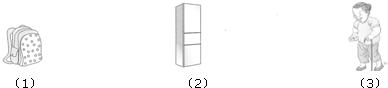

# Mathematics (Grade 3)

**ID**: affc1db5
**难度**: hard
**题型**: fill_in_the_blank

## 题目
下列的说法正确吗？正确的画“√”，错误的画“×”

（1）书包重5吨$\underline{\hspace{5em}}$      
（2）冰箱高15分米$\underline{\hspace{5em}}$      
（3）老奶奶重65克$\underline{\hspace{5em}}$      ．

## 解答

**答案**: ×, √, ×

1. Step1:分析（1）中书包重量，根据生活经验，书包质量通常用千克计量，5吨不符合实际，应为5千克，所以（1）说法错误
2. Step2:分析（2）中冰箱高度，15分米即1.5米，符合生活中冰箱高度的实际情况，所以（2）说法正确
3. Step3:分析（3）中老奶奶体重，根据生活常识，老奶奶体重应用千克计量，65克不符合实际，应为65千克，所以（3）说法错误

## 知识点

**知识点**:
  - 根据情景选择合适的计量单位

---
