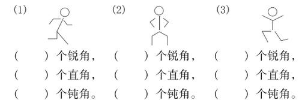

# Mathematics (Grade 3)

**ID**: b0e39e47
**难度**: hard
**题型**: fill_in_the_blank

## 题目
下列图形中分别有几个锐角、几个直角和几个钝角？

（）个锐角，                                          （）个锐角，                                           （）个锐角，
（）个直角，                                          （）个直角，                                          （）个直角，
（）个钝角。                                          （）个钝角。                                            （）个钝角。

## 解答

**答案**: 1, 1, 3, 0, 2, 3, 1, 0, 4

1. Step1:根据锐角是大于0°小于90°的角，观察第一个图形，数出锐角个数为1
2. Step2:根据直角是等于90°的角，观察第一个图形，数出直角个数为1
3. Step3:根据钝角是大于90°小于180°的角，观察第一个图形，数出钝角个数为3
4. Step4:根据锐角是大于0°小于90°的角，观察第二个图形，数出锐角个数为0
5. Step5:根据直角是等于90°的角，观察第二个图形，数出直角个数为2
6. Step6:根据钝角是大于90°小于180°的角，观察第二个图形，数出钝角个数为3
7. Step7:根据锐角是大于0°小于90°的角，观察第三个图形，数出锐角个数为1
8. Step8:根据直角是等于90°的角，观察第三个图形，数出直角个数为0
9. Step9:根据钝角是大于90°小于180°的角，观察第三个图形，数出钝角个数为4

## 知识点

**知识点**:
  - 角的认识

---
