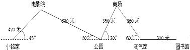

# Mathematics (Grade 3)

**ID**: b1130e1e
**难度**: hard
**题型**: fill_in_the_blank

## 题目
下面是小铭家到图书馆的路线图．

(1)电影院在小铭家______偏______的方向上，距离小铭家______米．
(2)电影院在公园______偏______的方向上，距离公园______米．
(3)商场在公园______偏______的方向上，距离公园______米．
(4)商场在淘气家______偏______的方向上，距离淘气家______米．
(5)图书馆在淘气家______方向上，距离淘气家______米．
(6)小铭家到图书馆，共行多少米？如果他每分钟步行80米，25分钟后他能不能到达图书馆？

## 解答

**答案**: 东, 北45°, 420, 西, 北30°, 630, 东, 北70°, 350, 西, 北60°, 360, 正东, 300

1. Step1:根据上北向南，左西右东的基本方位辨别法，以小铭家为观测点，确定电影院在小铭家东偏北45°的方向上，距离小铭家420米
2. Step2:以公园为观测点，确定电影院在公园西偏北30°的方向上，距离公园630米
3. Step3:以公园为观测点，确定商场在公园东偏北70°的方向上，距离公园350米
4. Step4:以淘气家为观测点，确定商场在淘气家西偏北60°的方向上，距离淘气家360米
5. Step5:以淘气家为观测点，确定图书馆在淘气家正东方向上，距离淘气家300米

## 知识点

**知识点**:
  - 根据方向和距离确定物体的位置;简单的行程问题．

---
