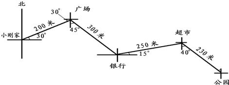

# Mathematics (Grade 3)

**ID**: b6578b61
**难度**: hard
**题型**: fill_in_the_blank

## 题目
看图，填一填．

（1）从小刚家出发，向$\underline{\hspace{5em}}$偏$\underline{\hspace{5em}}$゜走$\underline{\hspace{5em}}$米到达广场．
（2）从银行出发，向$\underline{\hspace{5em}}$偏$\underline{\hspace{5em}}$゜走$\underline{\hspace{5em}}$米到达超市．
（3）从公园出发，向$\underline{\hspace{5em}}$偏$\underline{\hspace{5em}}$゜走$\underline{\hspace{5em}}$米到达超市．
（4）从银行出发，向$\underline{\hspace{5em}}$偏$\underline{\hspace{5em}}$゜走$\underline{\hspace{5em}}$米到达广场．

## 解答

**答案**: 东, 北30, 200, 东, 北15, 250, 北, 西40, 230, 北, 西45, 300

1. Step1:根据地图方向辨别方法“上北下南，左西右东”以及图中信息，确定从小刚家到广场，是向东偏北30°方向走，距离为200米，得出（1）的答案东、北30、200
2. Step2:同样依据地图方向和图中信息，从银行到超市是向东偏北15°方向走，距离为250米，得出（2）的答案东、北15、250
3. Step3:根据地图方向及图中信息，从公园到超市是向北偏西40°方向走，距离为230米，得出（3）的答案北、西40、230
4. Step4:依据地图方向和图中信息，从银行到广场是向北偏西45°方向走，距离为300米，得出（4）的答案北、西45、300

## 知识点

**知识点**:
  - 路线图．

---
