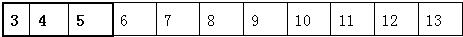

# Mathematics (Grade 3)

**ID**: b6cdd5e5
**难度**: hard
**题型**: fill_in_the_blank

## 题目
下图每次框出3个数，移动这个框，一共可以得到$\underline{\hspace{5em}}$个不同的和．每次框4个数可以框$\underline{\hspace{5em}}$个不同的和．

## 解答

**答案**: 9, 8

1. Step1:明确图中数字总共有11个，为3到13。
2. Step2:分析框出3个数的情况，因为最后的数字12和13后面没有两个数字可以框在一起，所以用数字总数11减去2，即11 - 2 = 9，得到框3个数时不同和的个数。
3. Step3:分析框出4个数的情况，由于最后的数字11、12和13后面没有三个数字可以框在一起，所以用数字总数11减去3，即11 - 3 = 8，得到框4个数时不同和的个数。

## 知识点

**知识点**:
  - 组合图形的计数．

---
