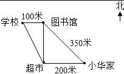

# Mathematics (Grade 3)

**ID**: b8fb6f54
**难度**: hard
**题型**: fill_in_the_blank

## 题目
看图填空：

（1）小华家在学校的 $\underline{\hspace{5em}}$ 方向，图书馆在超市的 $\underline{\hspace{5em}}$ 面；
（2）小华从家出发向 $\underline{\hspace{5em}}$ 方向走 $\underline{\hspace{5em}}$ 米到图书馆，再向 $\underline{\hspace{5em}}$ 面走 $\underline{\hspace{5em}}$ 米到学校．

## 解答

**答案**: 东南, 北, 西北, 350, 西, 100

1. Step1:根据地图方向辨别方法“上北下南，左西右东”，观察图可知小华家在学校右下方，所以小华家在学校的东南方向
2. Step2:观察图可知图书馆在超市的上方，所以图书馆在超市的北面
3. Step3:观察图可知图书馆在小华家左上方，所以小华从家出发向西北方向走，且图中标注小华家到图书馆距离为350米，即走350米到图书馆
4. Step4:观察图可知学校在图书馆的左边，所以从图书馆再向西面走，且图中标注图书馆到学校距离为100米，即走100米到学校

## 知识点

**知识点**:
  - 路线图

---
