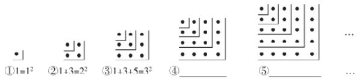

# Mathematics (Grade 3)

**ID**: bd2ef1c4
**难度**: hard
**题型**: fill_in_the_blank

## 题目
观察下面的点阵图和相应的等式，探究其中的规律。

1.在④和⑤后面的横线上分别写出相应的等式。
2.通过猜想写出与第n个点阵相对应的等式： $\underline{\hspace{5em}}$ 。
3.运用规律计算：1+3+5+7+…+199=（）。

## 解答

**答案**: 1+3+5+7=4^2, 1+3+5+7+9=5^2, 1+3+5+7+...+(2n-1)=n^2, 100^2

1. Step1:观察点阵图和等式，发现规律为几个连续奇数的和等于加数个数的平方。对于④，数出其点阵中相加的奇数有4个，所以等式为1+3+5+7=4^2
2. Step2:对于⑤，数出其点阵中相加的奇数有5个，所以等式为1+3+5+7+9=5^2
3. Step3:通过观察已有的等式，发现等式左边是连续的奇数和，等式右边是等式左边的首数与末数的平均数的平方，且这个平均数正好是点阵的序号，设点阵序号为n，奇数可表示为2n - 1，所以第n个点阵相对应的等式为1+3+5+7+…+(2n-1)=n^2
4. Step4:在1+3+5+7+…+199中，199是第(199 + 1)÷2 = 100个奇数，根据前面发现的规律，其结果为100^2

## 知识点

**知识点**:
  - 

---
