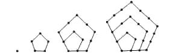

# Mathematics (Grade 3)

**ID**: cb0e2335
**难度**: hard
**题型**: fill_in_the_blank

## 题目
古希腊人常用小石子在沙滩上摆成各种形状来研究数，如图。

① ②     ③         ④
（1）根据摆出的石子，完成下面的统计。
$\begin{array}{|c|c|c|c|c|c|}
\hline
图号
 & ①
 & ②
 & ③
 & ④
 & ⑤
 \\\hline
五边形的个数（个）
 & 0
 & 1
 & 2
 & （\underline{\hspace{5em}}）
 & （\underline{\hspace{5em}}）
 \\\hline
石子的个数（个）
 & 1
 & 5
 & （\underline{\hspace{5em}}）
 & （\underline{\hspace{5em}}）
 & （\underline{\hspace{5em}}）
 \\\hline
\end{array}$
（2）按上面的规律，第10幅图有（______）个石子。

## 解答

**答案**: 3, 4, 12, 22, 35, 145

1. Step1:观察图形可知，图①没有五边形，五边形个数为0；图②有1个五边形；图③有2个五边形，按照此规律，图④五边形个数为3，图⑤五边形个数为4
2. Step2:计算石子个数，图①石子个数为1个；图②石子个数是在图①基础上增加4个，即1 + 4 = 5个；图③石子个数是在图②基础上增加7个，即1 + 4 + 7 = 12个；图④石子个数是在图③基础上增加10个，即1 + 4 + 7 + 10 = 22个；图⑤石子个数是在图④基础上增加13个，即1 + 4 + 7 + 10 + 13 = 35个
3. Step3:计算第10幅图石子个数，根据前面规律，其石子个数为1＋4＋7＋10＋13＋16＋19＋22＋25＋28 = 145个

## 知识点

**知识点**:
  - 小学数学;探索规律;图形的变化规律

---
