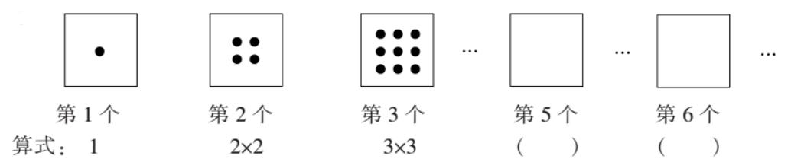

# Mathematics (Grade 3)

**ID**: d0137692
**难度**: hard
**题型**: fill_in_the_blank

## 题目
观察点阵规律，填一填。
 
第n个点阵有（）个点。

## 解答

**答案**: 5*5, 6*6, n**2

1. Step1:观察前三个点阵，第一个点阵点的个数为1×1，第二个点阵点的个数为2×2，第三个点阵点的个数为3×3
2. Step2:根据前面发现的规律，可得第5个点阵点的个数为5×5
3. Step3:同理，第6个点阵点的个数为6×6
4. Step4:分析上述规律，发现第n个点阵点的个数为n×n，即n**2

## 知识点

**知识点**:
  - 

---
