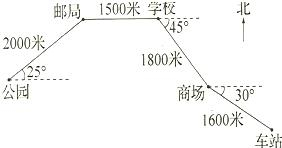

# Mathematics (Grade 3)

**ID**: d02b6f49
**难度**: hard
**题型**: fill_in_the_blank

## 题目
下面是8路公共汽车行驶的路线图．
（1）8路公共汽车从公园出发，向$\underline{\hspace{5em}}$偏$\underline{\hspace{5em}}$25度的方向行$\underline{\hspace{5em}}$米到达邮局，再向$\underline{\hspace{5em}}$行$\underline{\hspace{5em}}$米到达学校．
（2）由学校向$\underline{\hspace{5em}}$偏$\underline{\hspace{5em}}$45°的方向行$\underline{\hspace{5em}}$米到达商场，再由商场向东偏$\underline{\hspace{5em}}$的方向行$\underline{\hspace{5em}}$米到达车站．

## 解答

**答案**: 东, 北, 2000, 东, 1500, 东, 南, 1800, 南30°, 1600

1. Step1:根据地图方向辨别方法'上北下南，左西右东'以及图中信息，8路公共汽车从公园出发，向东北方向，具体是东偏北25度的方向行2000米到达邮局
2. Step2:从邮局出发，根据方向辨别方法和图中信息，再向东行1500米到达学校
3. Step3:从学校出发，依据方向辨别方法和图中信息，由学校向东偏南45°的方向行1800米到达商场
4. Step4:从商场出发，根据方向辨别方法和图中信息，再由商场向东偏南30°的方向行1600米到达车站

## 知识点

**知识点**:
  - 路线图．

---
