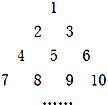

# Mathematics (Grade 3)

**ID**: d2ad19d1
**难度**: hard
**题型**: fill_in_the_blank

## 题目
仔细观察如图，寻找其中规律，试判断：第20行从左往右数第12个数是$\underline{\hspace{5em}}$．

## 解答

**答案**: 202

1. Step1:分析数的排列规律，得出第n - 1行结束时排的数的个数为1+2+3+…+n - 1，根据等差数列求和公式，其和为$\frac{1}{2}$n（n - 1）个
2. Step2:由此可知第n行从左向右的第12个数是在第n - 1行结束时的数的个数基础上加上12，即$\frac{1}{2}$n（n - 1）+12
3. Step3:题目要求第20行从左往右数第12个数，将n = 20代入到$\frac{1}{2}$n（n - 1）+12中
4. Step4:计算$\frac{1}{2}$×20×19+12，先算$\frac{1}{2}$×20×19 = 190，再算190 + 12 = 202，得出结果为202

## 知识点

**知识点**:
  - 数表中的规律．

---
