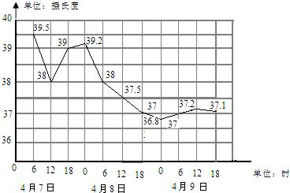

# Mathematics (Grade 3)

**ID**: d749da03
**难度**: hard
**题型**: fill_in_the_blank

## 题目
下面是一个病人的提问记录折线图．

（1）护士每隔（   ）小时给病人测量一次体温．
（2）该病人这几天的最高体温是（   ）摄氏度，最低体温是（   ）摄氏度，相差（   ） $\underline{\hspace{5em}}$ 摄氏度．

## 解答

**答案**: 6, 39.5, 36.8, 2.7

1. Step1:观察折线图的横轴时间，计算相邻测量时间的间隔，12 - 6 = 6，得出护士每隔6小时给病人测量一次体温
2. Step2:观察折线图，找出折线中最高的点对应的体温值，得到最高体温是39.5摄氏度
3. Step3:观察折线图，找出折线中最低的点对应的体温值，得到最低体温是36.8摄氏度
4. Step4:用最高体温39.5摄氏度减去最低体温36.8摄氏度，即39.5 - 36.8 = 2.7，得出相差2.7摄氏度

## 知识点

**知识点**:
  - 

---
