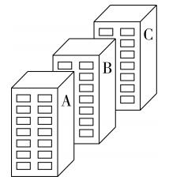

# Mathematics (Grade 3)

**ID**: e02f5be5
**难度**: hard
**题型**: fill_in_the_blank

## 题目
小华居住在都市花园小区。 该小区有A、B和C三个单元，门牌号码由单元+层数+房号编成。如小区的B单元10层5号房号就用B-10-05表示。小华家居住在该小区的A单元4层2号房，你来给她家编门牌号码吧。

## 解答

**答案**: A-04-02

1. Step1:明确小区门牌号码的编码规则为单元+层数+房号，中间用'-'连接
2. Step2:确定小华家所在单元为A单元
3. Step3:确定小华家所在层数为4层，按编码规则写成04
4. Step4:确定小华家房号为2号，按编码规则写成02
5. Step5:按照编码规则将单元、层数、房号组合起来，得到A-04-02

## 知识点

**知识点**:
  - 编码

---
