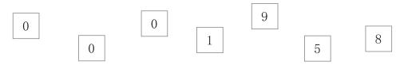

# Mathematics (Grade 3)

**ID**: e075fd9f
**难度**: hard
**题型**: fill_in_the_blank

## 题目
我会用下面的7个数字做组数游戏。

一个“零”也不读的数是（）；只读一个“零”的数是（）；只读两个“零”的数是（）；读三个“零”的数是（）。

## 解答

**答案**: 1958000, 1950008, 1095008, 1090508

1. Step1:根据读数规则，要得到一个‘零’也不读的数，把3个0放到一个数级的末尾，4个非零数字1、9、5、8随意摆，得到1958000
2. Step2:要得到只读一个‘零’的数，把1个0放到一个数级的中间，其它2个0放到一个数级的末尾，4个非零数字1、9、5、8随意摆放，得到1950008
3. Step3:要得到只读两个‘零’的数，把二个0分别放到数级的中间，另1个0放到数级的末尾，4个非零数字1、9、5、8随意摆放，得到1095008
4. Step4:要得到读三个‘零’的数，把3个0放到任意两个非零数字中间，4个非零数字1、9、5、8随意摆放，得到1090508

## 知识点

**知识点**:
  - 整数的读法和写法

---
