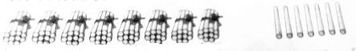

# Mathematics (Grade 3)

**ID**: f13b7374
**难度**: hard
**题型**: fill_in_the_blank

## 题目
看图填算式．

 $\underline{\hspace{5em}}$ + $\underline{\hspace{5em}}$ = $\underline{\hspace{5em}}$ ； $\underline{\hspace{5em}}$ - $\underline{\hspace{5em}}$ = $\underline{\hspace{5em}}$ ；
 $\underline{\hspace{5em}}$ + $\underline{\hspace{5em}}$ = $\underline{\hspace{5em}}$ ； $\underline{\hspace{5em}}$ - $\underline{\hspace{5em}}$ = $\underline{\hspace{5em}}$ ．

## 解答

**答案**: 80, 7, 87, 87, 80, 7, 7, 80, 87, 87, 7, 80

1. Step1:观察图片，看到左侧有8捆小棒，因为每捆10根，所以左侧小棒数量为8×10 = 80根
2. Step2:观察图片，看到右侧有7根小棒
3. Step3:根据加法意义，将左侧小棒数量80和右侧小棒数量7合起来，得到80 + 7 = 87
4. Step4:交换加数位置，得到7 + 80 = 87
5. Step5:根据减法意义，用小棒总数87减去左侧小棒数量80，得到87 - 80 = 7
6. Step6:用小棒总数87减去右侧小棒数量7，得到87 - 7 = 80

## 知识点

**知识点**:
  - 图文应用题

---
