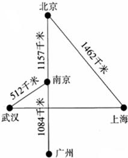

# Mathematics (Grade 3)

**ID**: f28eec0a
**难度**: hard
**题型**: fill_in_the_blank

## 题目
（1）看图填数．
从北京到上海$\underline{\hspace{5em}}$千米．
从武汉到南京$\underline{\hspace{5em}}$千米．
从北京到南京$\underline{\hspace{5em}}$千米．
从北京到广州$\underline{\hspace{5em}}$千米．
（2）在横线里填上方位词．（东、南、西、北）
北京在南京的$\underline{\hspace{5em}}$面．
广州在南京的$\underline{\hspace{5em}}$面．
武汉在上海的$\underline{\hspace{5em}}$面．
上海在武汉的$\underline{\hspace{5em}}$面．

## 解答

**答案**: 1462, 512, 1157, 2241, 北, 南, 西, 东

1. Step1:观察图中北京到上海的距离标注，得出从北京到上海1462千米
2. Step2:观察图中武汉到南京的距离标注，得出从武汉到南京512千米
3. Step3:观察图中北京到南京的距离标注，得出从北京到南京1157千米
4. Step4:观察图中北京到南京距离为1157千米，南京到广州距离为1084千米，将二者相加1157+1084=2241千米，得出从北京到广州2241千米
5. Step5:根据“上北下南，左西右东”，北京在南京上方，得出北京在南京的北面
6. Step6:根据“上北下南，左西右东”，广州在南京下方，得出广州在南京的南面
7. Step7:根据“上北下南，左西右东”，武汉在上海左方，得出武汉在上海的西面
8. Step8:根据“上北下南，左西右东”，上海在武汉右方，得出上海在武汉的东面

## 知识点

**知识点**:
  - 整数的加法和减法；方向．

---
