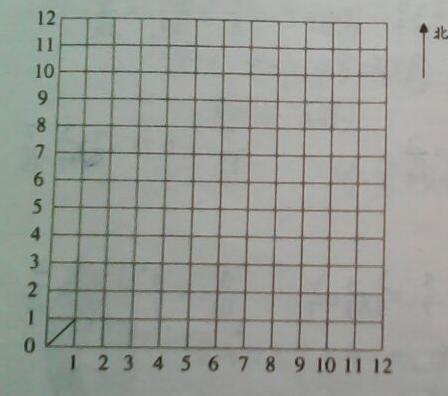

# Mathematics (Grade 3)

**ID**: f4b66156
**难度**: hard
**题型**: fill_in_the_blank

## 题目
如图，如果一个小正方形的对角线长10米，则点（0，0）东偏北45°方向30米处是点（ ，）；点（4，2）北偏西45°方向20米处是点（ ，）；点（6，7）北偏东45°方向10米处是点（ ，）；点（4，4）西偏北45°方向40米处是点（ ，）．.

## 解答

**答案**: 3, 3, 2, 4, 7, 8, 0, 8

1. Step1:明确一个小正方形对角线长10米，那么30米是3个对角线长度，20米是2个对角线长度，10米是1个对角线长度，40米是4个对角线长度
2. Step2:对于点（0，0）东偏北45°方向30米处，东偏北45°方向移动，列数和行数变化相同，移动3个对角线长度，列数和行数都增加3，得到点（3，3）
3. Step3:对于点（4，2）北偏西45°方向20米处，北偏西45°方向移动，列数减少，行数增加，移动2个对角线长度，列数减2为2，行数加2为4，得到点（2，4）
4. Step4:对于点（6，7）北偏东45°方向10米处，北偏东45°方向移动，列数和行数都增加，移动1个对角线长度，列数加1为7，行数加1为8，得到点（7，8）
5. Step5:对于点（4，4）西偏北45°方向40米处，西偏北45°方向移动，列数减少，行数增加，移动4个对角线长度，列数减4为0，行数加4为8，得到点（0，8）
6. Step6:将各点的列数和行数依次排列，得到['3', '3', '2', '4', '7', '8', '0', '8']

## 知识点

**知识点**:
  - 

---
