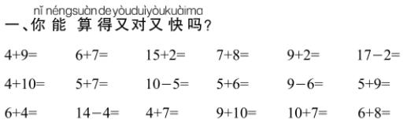

# Mathematics (Grade 3)

**ID**: f6a28b0d
**难度**: hard
**题型**: fill_in_the_blank

## 题目

4+9=    6+7=    15+2=    7+8=    9+2=    17-2=
4+10=   5+7=    10-5=    5+6=    9-6=    5+9=   
6+4=    14-4=    4+7=    9+10=    10+7=    6+8=

## 解答

**答案**: 13, 13, 17, 15, 11, 15, 14, 12, 5, 11, 3, 14, 10, 10, 11, 19, 17, 14

1. Step1:计算4+9，个位4+9=13，满十向十位进1，结果为13
2. Step2:计算6+7，个位6+7=13，满十向十位进1，结果为13
3. Step3:计算15+2，个位5+2=7，结果为17
4. Step4:计算7+8，个位7+8=15，满十向十位进1，结果为15
5. Step5:计算9+2，个位9+2=11，结果为11
6. Step6:计算17-2，个位7-2=5，结果为15
7. Step7:计算4+10，结果为14
8. Step8:计算5+7，个位5+7=12，满十向十位进1，结果为12
9. Step9:计算10-5，个位0-5不够减，从十位借1当10，10-5=5，结果为5
10. Step10:计算5+6，个位5+6=11，满十向十位进1，结果为11
11. Step11:计算9-6，个位9-6=3，结果为3
12. Step12:计算5+9，个位5+9=14，满十向十位进1，结果为14
13. Step13:计算6+4，个位6+4=10，满十向十位进1，结果为10
14. Step14:计算14-4，个位4-4=0，结果为10
15. Step15:计算4+7，个位4+7=11，满十向十位进1，结果为11
16. Step16:计算9+10，结果为19
17. Step17:计算10+7，结果为17
18. Step18:计算6+8，个位6+8=14，满十向十位进1，结果为14

## 知识点

**知识点**:
  - 进位加法;退位减法

---
