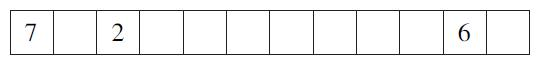

# Mathematics (Grade 3)

**ID**: fbc81dfb
**难度**: hard
**题型**: fill_in_the_blank

## 题目
在□里填数，使每相邻的三个数的和是15。 

## 解答

**答案**: 7, 6, 2, 7, 6, 2, 7, 6, 2, 7, 6, 2

1. Step1:已知第一个数是7，第三个数是2，因为每相邻三个数的和是15，所以第二个数为15 - 7 - 2 = 6
2. Step2:已知第二个数是6，第三个数是2，所以第四个数为15 - 6 - 2 = 7
3. Step3:已知第三个数是2，第四个数是7，所以第五个数为15 - 2 - 7 = 6
4. Step4:已知第四个数是7，第五个数是6，所以第六个数为15 - 7 - 6 = 2
5. Step5:已知第五个数是6，第六个数是2，所以第七个数为15 - 6 - 2 = 7
6. Step6:已知第六个数是2，第七个数是7，所以第八个数为15 - 2 - 7 = 6
7. Step7:已知第七个数是7，第八个数是6，所以第九个数为15 - 7 - 6 = 2
8. Step8:已知第八个数是6，第九个数是2，所以第十个数为15 - 6 - 2 = 7
9. Step9:已知第九个数是2，第十个数是7，所以第十一个数为15 - 2 - 7 = 6
10. Step10:已知第十个数是7，第十一个数是6，所以第十二个数为15 - 7 - 6 = 2

## 知识点

**知识点**:
  - 整数的加法和减法

---
