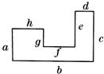

# Mathematics (Grade 3)

**ID**: 29032127
**难度**: hard
**题型**: multiple_choice

## 题目
如图是一座楼房的平面图，图中不同字母表示长度不同的各条边长，若b=50米，c=30米，g=10米，则这座楼房平面图的周长是（  ）
A．90米
B．150米
C．180米

## 解答

**答案**: C

1. Step1:根据解析2可知，将相应线段平移后，楼房平面图的周长=长为b宽为c的长方形的周长+2g
2. Step2:长方形周长公式为(长 + 宽)×2，所以长为b宽为c的长方形周长为(c + b)×2
3. Step3:已知b = 50米，c = 30米，g = 10米，将其代入式子(c + b)×2 + 2g，得到(30 + 50)×2 + 2×10
4. Step4:先计算括号内30 + 50 = 80，再算80×2 = 160，2×10 = 20
5. Step5:最后计算160 + 20 = 180米，所以答案选C

## 知识点

**知识点**:
  - 巧算周长．

---
