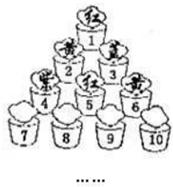

# Mathematics (Grade 3)

**ID**: 375dfdd5
**难度**: hard
**题型**: multiple_choice

## 题目
把编号为1，2，3，4，…的若干盆花按右图所示摆放，花盆中的花按红．黄．蓝．紫的颜色依次循环排列，则第8行从左边数第6盆花的颜色为（  ）色．
A．红
B．黄
C．蓝
D．紫

## 解答

**答案**: B

1. Step1:分析花盆数量规律，可知第一层有1盆，第二层有2盆，第三层有3盆，第四层有4盆，……，第八层有8盆
2. Step2:计算到第8层第6盆花的总盆数，即1+2+3+4+5+6+7+6=34盆
3. Step3:明确花的颜色循环规律为四盆一个循环周期，按红、黄、蓝、紫的颜色依次循环排列
4. Step4:计算34÷4=8…2，得出第34盆花在第9个循环周期的第2盆
5. Step5:因为每个循环周期内第二盆花为黄色，所以第8行从左边数第6盆花的颜色为黄色

## 知识点

**知识点**:
  - 数与形结合的规律．

---
