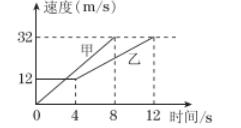

# Mathematics (Grade 3)

**ID**: 38d1e676
**难度**: hard
**题型**: multiple_choice

## 题目
如图是甲、乙两车在某时段速度随时间变化的图象，下列结论错误的是（）

A.乙前4秒行驶的路程为48m
B.在0～8s内甲的速度每秒增加4m/s
C.两车到第3s时行驶的路程相等
D.在4～8s内甲的速度都大于乙的速度

## 解答

**答案**: C

1. Step1:分析选项A，由图象可知乙前4秒速度不变为12米/秒，根据路程=速度×时间，可得乙前4秒行驶路程为12×4 = 48米，所以选项A正确
2. Step2:分析选项B，由图象知在0 - 8s内甲的速度图象是过原点直线，速度从0均匀增加到32米/秒，那么每秒增加速度为32÷8 = 4米/秒，所以选项B正确
3. Step3:分析选项C，甲的速度v与时间t关系为v = 4t（因为甲图象是过原点直线且每秒速度增加4米/秒），当v = 12m/s时，代入v = 4t得t = 3s，在3s前甲速度小于乙速度，根据路程=速度×时间，可知两车到第3秒时行驶路程不相等，所以选项C错误
4. Step4:分析选项D，观察图象可知在4 - 8s内甲的速度图象一直在乙上方，所以在4 - 8s内甲的速度都大于乙的速度，选项D正确

## 知识点

**知识点**:
  - 实际问题中的函数关系所表示的函数图象;用图象表示变量间关系

---
