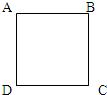

# Mathematics (Grade 3)

**ID**: 41cddb64
**难度**: hard
**题型**: multiple_choice

## 题目
如图是一个边长为p60米的正方形，甲、乙两人同时从2点出发，甲逆时针每分行7左米，乙顺时针每分行4左米．两人第一次在CD边（不在CD两点）上相遇，是出发后的（  ）次相遇．
$\begin{description}
\item A．4\item B．5\item C．6\item D．7
\end{description}$

## 解答

**答案**: D

1. Step1:计算正方形的周长，边长为60米，周长为60×4 = 240米
2. Step2:计算两人的速度和，甲每分行75米，乙每分行45米，速度和为75 + 45 = 120米/分
3. Step3:根据路程和速度和求出第一次相遇时间，240÷120 = 2分
4. Step4:计算第一次相遇时乙走的路程，45×2 = 90米
5. Step5:第一次相遇后，每次相遇两人走过的路程和都是正方形的周长240米，所以每次相遇乙走的路程都是90米
6. Step6:依次计算每次相遇乙走的总路程，第一次90米，第二次90×2 = 180米，第三次90×3 = 270米，第四次90×4 = 360米，第五次90×5 = 450米，第六次90×6 = 540米，第七次90×7 = 630米
7. Step7:根据乙走的总路程判断相遇位置，第一次相遇在BC边，第二次相遇在D点，第三次相遇在AB边，第四次相遇在C点，第五次相遇在AD边，第六次相遇在B点，第七次相遇在CD边

## 知识点

**知识点**:
  - 相遇问题．

---
