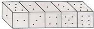

# Mathematics (Grade 3)

**ID**: 4f8c2878
**难度**: hard
**题型**: multiple_choice

## 题目
有五颗相同的骰子放成一排（如图），五颗骰子底面的点数之和是（  ）

A．15
B．16
C．19
D．20

## 解答

**答案**: C

1. Step1:根据图示，确定每颗骰子相对的面，即1对6，2对5，3对4
2. Step2:计算每颗骰子相对面两个数字的和，1+6=7，2+5=7，3+4=7
3. Step3:计算5颗骰子相对面数字总和，7×5=35
4. Step4:找出5颗骰子上面的数字分别为5、2、1、3、5，并计算其和，5+2+1+3+5=16
5. Step5:用5颗骰子相对面数字总和减去5颗骰子上面数字的和，35 - 16 = 19，得出五颗骰子底面的点数之和

## 知识点

**知识点**:
  - 数与形结合的规律．

---
