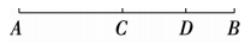

# Mathematics (Grade 3)

**ID**: 5a76bf10
**难度**: hard
**题型**: multiple_choice

## 题目
如图，C是线段AB的中点，D是线段CB上一点，下列说法错误的是（）

A.CD=AC-BD
B.CD=$\frac{1}{2}$BC
C.CD=$\frac{1}{2}$AB-BD
D.CD=AD-BC

## 解答

**答案**: B

1. Step1:因为C是线段AB的中点，所以得出AC=BC=$rac{1}{2}$AB
2. Step2:分析选项A，由CD=BC - BD，将BC替换为AC，可得CD=AC - BD，判断该选项正确
3. Step3:分析选项B，因为D不一定是BC的中点，所以CD=$rac{1}{2}$BC不一定成立，判断该选项错误
4. Step4:分析选项C，由CD=BC - BD，将BC替换为$rac{1}{2}$AB，可得CD=$rac{1}{2}$AB - BD，判断该选项正确
5. Step5:分析选项D，由CD=AD - AC，将AC替换为BC，可得CD=AD - BC，判断该选项正确

## 知识点

**知识点**:
  - 线段中点的定义及应用;线段的和差

---
