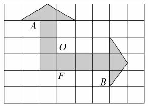

# Mathematics (Grade 3)

**ID**: 627f094b
**难度**: hard
**题型**: multiple_choice

## 题目
先看图，再判断。

1.由图A绕点O顺时针旋转90°，得到图B。（）
2.由图B绕点O逆时针旋转90°，得到图A。（）
3.由图A绕点F逆时针旋转90°，得到图B。（）
4.由图B绕点F逆时针旋转90°，得到图A。（）

## 解答

**答案**: 4

1. Step1:观察图形，明确本题考查旋转相关知识，关键在于确定旋转中心和方向。
2. Step2:根据图形判断出图形A与图形B旋转变换时的旋转中心是点F，不是点O，所以由图A绕点O顺时针旋转90°得到图B的说法错误，对应1错误。
3. Step3:同理，由图B绕点O逆时针旋转90°得到图A的说法错误，对应2错误。
4. Step4:判断由图A绕点F逆时针旋转90°不能得到图B，对应3错误。
5. Step5:判断由图B绕点F逆时针旋转90°可以得到图A，对应4正确。
6. Step6:题目要求找出正确的说法，所以答案为4

## 知识点

**知识点**:
  - 图形的旋转

---
