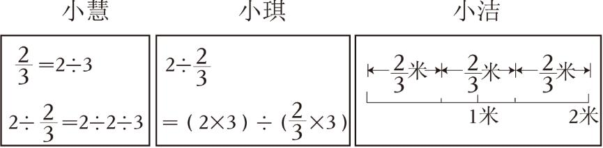

# Mathematics (Grade 3)

**ID**: 99e93cc4
**难度**: hard
**题型**: multiple_choice

## 题目
为了得到2÷$\frac{2}{3}$的结果，同学们用了三种不同的方法，想法错误的是（    ）。 

$\begin{description}
\item A.小慧\item B.小琪\item C.小洁
\end{description}$

## 解答

**答案**: A

1. Step1:根据分数与除法的关系，可知$rac{2}{3}$＝2÷3，那么2÷$rac{2}{3}$＝2÷（2÷3），根据去括号法则，2÷（2÷3）＝2÷2×3，所以小慧的2÷$rac{2}{3}$＝2÷2÷3错误。
2. Step2:根据商不变的性质，2÷$rac{2}{3}$＝（2×3）÷（$rac{2}{3}$×3）＝6÷2＝3，小琪的方法正确。
3. Step3:因为1米里面有1÷$rac{2}{3}$＝$rac{3}{2}$个$rac{2}{3}$米，所以2米里面有$rac{3}{2}$×2＝3个$rac{2}{3}$米，小洁的方法正确。
4. Step4:综上，想法错误的是小慧，答案选A。

## 知识点

**知识点**:
  - 

---
