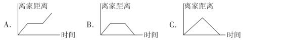

# Mathematics (Grade 3)

**ID**: ba8cb5e7
**难度**: hard
**题型**: multiple_choice

## 题目
小明从家去书店买书，中途休息了几分钟，到书店买完书后直接回家，下面正确描述小明这一过程的图是（）

## 解答

**答案**: B

1. Step1:将小明的行程分为从家出发到途中休息前、途中休息、到书店买完书后回家这三个阶段
2. Step2:分析从家出发到途中休息前这一阶段，可知离家的距离越来越远
3. Step3:分析途中休息这一阶段，可知离家的距离不变
4. Step4:分析到书店买完书后回家这一阶段，可知离家的距离越来越近
5. Step5:观察选项A，其没有体现出回家时离家距离越来越近的过程，不符合行程
6. Step6:观察选项B，其先体现离家距离越来越远，然后距离不变，最后距离越来越近，符合行程
7. Step7:观察选项C，其没有体现出途中休息时离家距离不变的过程，不符合行程
8. Step8:综上，正确答案是B

## 知识点

**知识点**:
  - 

---
