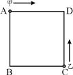

# Mathematics (Grade 3)

**ID**: c42dfa46
**难度**: hard
**题型**: multiple_choice

## 题目
如图，甲、乙两动点分别从正方形ABCD的顶点A、C同时沿正方形的边开始移动，甲点依顺时针方向环行，乙点依逆时针方向环行．若乙的速度是甲的速度的5倍，则它们第2010次相遇在边 (  )上．
A．AB
B．BC
C．CD
D．DA

## 解答

**答案**: A

1. Step1:根据乙速度是甲速度的5倍，可知第1次相遇时，甲乙共走了半个周长，甲走了正方形周长的$\frac{1}{2}×\frac{1}{6}=\frac{1}{12}$，即AD长度的$\frac{1}{3}$，第一次相遇在AD边上
2. Step2:第二次相遇时，甲和乙共走了一个周长，甲又走了AD长度的$\frac{2}{3}$，故甲乙第二次相遇于D点
3. Step3:从第2次相遇起，每次甲走了正方形周长的$\frac{1}{6}$，且从第2次相遇起，6次一个循环
4. Step4:计算2010 - 1 = 2009，这是除去第一次相遇后剩余的相遇次数
5. Step5:计算2009÷6 = 334余5
6. Step6:根据从第2次相遇起，每次相遇的位置依次是点D，DC，点C，BC，点B，AB，可知余数为5时，相遇位置在AB边上

## 知识点

**知识点**:
  - 多次相遇问题．

---
