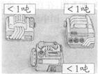

# Mathematics (Grade 3)

**ID**: cc19c17b
**难度**: hard
**题型**: multiple_choice

## 题目
一艘货船上卸下了若干台机器，这些机器的总质量是l9吨，但每台机器的质量都不超过l吨．如果用载重3吨的汽车把这些机器运到仓库，那么至少需要(    )辆这样的汽车才能保证一次运完．

## 解答

**答案**: 9

1. Step1:明确要保证一次运完需考虑最糟糕情况，即让机器数量尽可能多，那就得让每台机器尽可能轻，使每辆车只能运3台机器（运4台就超重）
2. Step2:计算每台机器重量为3÷4 = 0.75吨，当机器重量为0.75吨时每车可运4台，当机器重量＞0.75吨时为糟糕情况
3. Step3:取机器重量为0.76吨（大于0.75吨），计算机器总数为19÷0.76 = 25台
4. Step4:计算25台机器用载重3吨的汽车运输，25÷3 = 8辆…1台
5. Step5:得出至少需要8 + 1 = 9辆汽车才能保证一次运完

## 知识点

**知识点**:
  - 抽屉原理．

---
