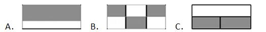

# Mathematics (Grade 3)

**ID**: dc37d340
**难度**: hard
**题型**: multiple_choice

## 题目
下面图形从左向右第（）图不能用$\frac{1}{2}$表示阴影部分面积。

## 解答

**答案**: A

1. Step1:明确分数\(rac{1}{2}\)的意义，即把一个整体平均分成2份，取其中的一份。
2. Step2:分析图A，此图被分成了2份，但不是平均分，根据分数意义，不能用\(rac{1}{2}\)表示阴影部分面积。
3. Step3:分析图B，此图被平均分成6份，阴影部分为3份，\(rac{3}{6}=rac{1}{2}\)，所以阴影部分面积能用\(rac{1}{2}\)表示。
4. Step4:分析图C，此图被平均分成2份，阴影部分为1份，其中阴影部分又被平均分成2份，阴影部分占整个图形的\(rac{1}{2}	imesrac{2}{2}=rac{1}{2}\)，所以阴影部分面积能用\(rac{1}{2}\)表示。
5. Step5:综上，从左向右第A图不能用\(rac{1}{2}\)表示阴影部分面积。

## 知识点

**知识点**:
  - 分数的初步认识

---
