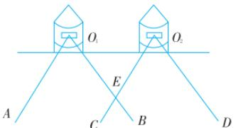

# Mathematics (Grade 3)

**ID**: 1d431699
**难度**: hard
**题型**: short_answer

## 题目
下图是敌人碉堡里两盏探照灯扫射的区域。

（1）游击队员通过敌封锁线时，什么区域不容易被敌人发现？为什么？
（2）从什么区域通过封锁线最困难？说说你的理由。

## 解答

**答案**: 从$O_{1}$E$O_{2}$区域通过不容易被敌人发现，因为两盏探照灯都照不到，是敌人的视觉盲区。, 从CEB区域通过封锁线最困难，因为两盏探照灯都可以照到这个地方，此区域被照射的时间最长。

1. Step1:观察图形，思考两盏探照灯照射范围，确定寻找两盏探照灯都照不到的区域来回答第（1）题
2. Step2:发现$O_{1}$E$O_{2}$区域是两盏探照灯都照不到的地方，得出从$O_{1}$E$O_{2}$区域通过不容易被敌人发现，因为是敌人的视觉盲区
3. Step3:再次观察图形，思考寻找两盏探照灯都能照到的区域来回答第（2）题
4. Step4:发现CEB区域是两盏探照灯都能照到的地方，得出从CEB区域通过封锁线最困难，因为此区域被照射的时间最长

## 知识点

**知识点**:
  - 不同位置观察物体的范围

---
